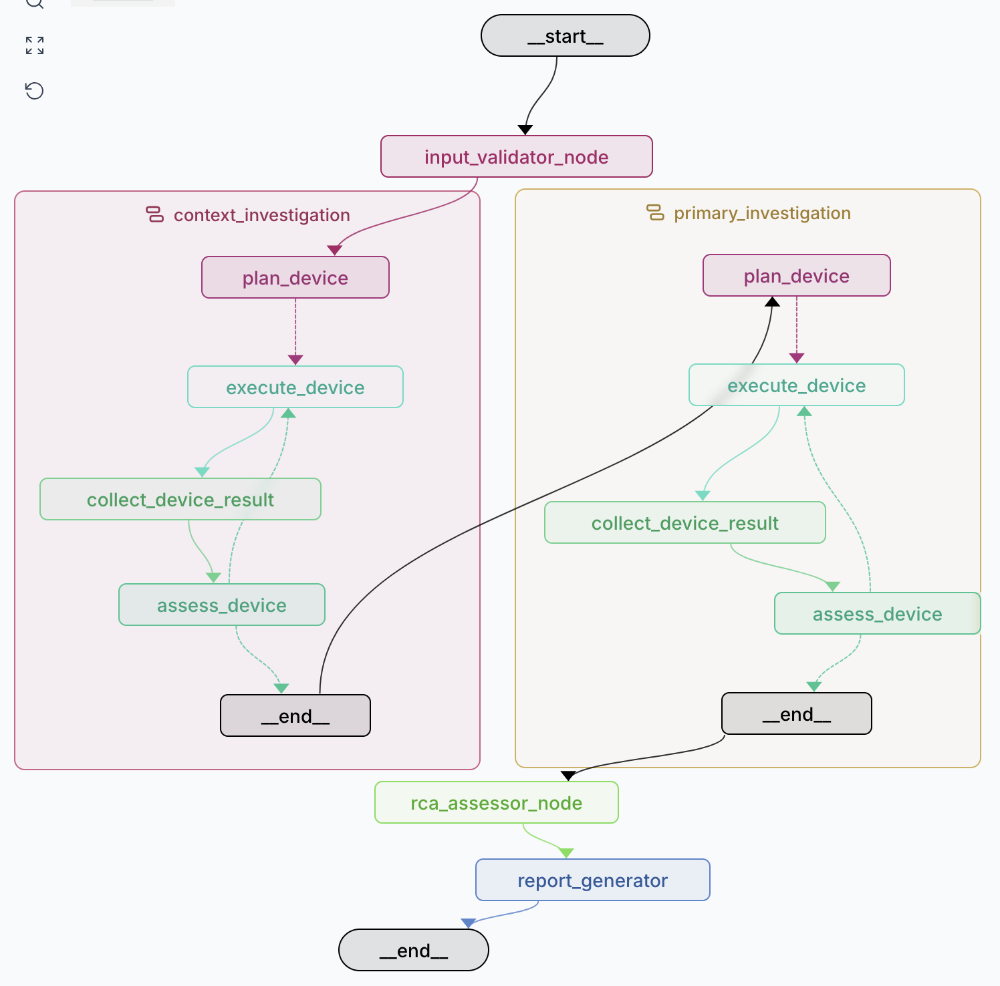

# SP Oncall: Multi-Agent Network Investigation

[](https://developer.cisco.com/codeexchange/github/repo/jillesca/sp_oncall)

SP Oncall is an experimental AI-driven network investigation system for Service Provider (SP) networks. It automates network diagnostics and troubleshooting by analyzing device state, identifying issues, and generating detailed root-cause reports. I'm mostly using it to learn and demo about AI solutions for networking.

## What Does It Do?

Think of SP Oncall as a team of specialized AI agents that work together to investigate network problems:

- **Input Validator** — Understands the incoming query or alert and decides which devices belong to the investigation.
- **Context Investigation** — Investigates related devices first, such as neighbors or surrounding topology, to build supporting context.
- **Primary Investigation** — Investigates the main target devices using the context-phase findings.
- **RCA Assessor** — Reviews the completed investigation phases and extracts the most likely root cause.
- **Report Generator** — Produces the final human-readable report and updates per-device history.

## Architecture

The graph is a linear orchestration pipeline: `input_validator_node → context_investigation → primary_investigation → rca_assessor_node → report_generator`. Each investigation phase is a sub-graph that handles its own retries internally.

Inside each investigation sub-graph, you'll see four internal nodes in LangGraph Studio: `plan_device` (creates investigation strategy), `execute_device` (queries network devices), `collect_device_result` (aggregates findings), and `assess_device` (evaluates if objective is met). If assessment fails and retries remain, the phase loops back to execute.



## Key Features

- **Optional alert integration**: Connect to an external observability stack (like [xrd-observability-stack](https://github.com/CiscoDevNet/xrd-observability-stack)) through the bundled webhook proxy for automated investigations triggered by network alerts.
- **Per-device memory**: Device Profiles store role, BGP AS, neighbors, and topology facts across runs, plus last alert and health status — all in the LangGraph Store, no external DB required.
- **Two-phase investigations**: Context phase investigates related devices (neighbors, topology) first; primary phase investigates target devices using context findings.
- **Multi-device concurrency**: Multiple devices are investigated in parallel within each phase.
- **Internal retry loop**: Each phase can retry up to `max_retries` times (default: 3) before moving on.
- **Skill-based planning**: Investigation strategies live in `skills/` as Markdown files. Manual queries use all skills; alert-triggered investigations filter by event type.

## Prerequisites

Before you can use SP Oncall, you'll need these tools installed on your system:

- **Make** — A build automation tool that helps run common commands (install via your package manager).
- **[uv](https://docs.astral.sh/uv/#installation)** — A fast Python package manager (alternative to pip).
- **[OpenAI API Key](https://platform.openai.com/)** — Required if using OpenAI models (default). OpenRouter is also supported.
- **[LangSmith Account](https://smith.langchain.com/)** — For LangGraph Studio.
- **Network Devices** — Your actual network equipment, or use the [DevNet XRd Sandbox](https://devnetsandbox.cisco.com/DevNet/) for testing.
- **[gNMIBuddy](https://github.com/jillesca/gNMIBuddy)** — A gNMI MCP server that provides a simple interface to query network devices. SP Oncall uses it to interact with network devices.

**Windows users**: This project requires a Unix-like environment. Install [WSL (Windows Subsystem for Linux)](https://docs.microsoft.com/en-us/windows/wsl/install) to run it on Windows.

## Quick Start

### 1. Clone and install

```bash
git clone https://github.com/jillesca/sp_oncall
cd sp_oncall
make install
```

### 2. Configure environment

Copy `.env.example` to `.env` and fill in the required values:

```bash
cp .env.example .env
```

Required keys:

| Variable            | Description                               |
| ------------------- | ----------------------------------------- |
| `OPENAI_API_KEY`    | OpenAI API key                            |
| `LANGSMITH_API_KEY` | LangSmith API key (for tracing)           |
| `LANGSMITH_PROJECT` | LangSmith project name (e.g. `sp_oncall`) |
| `LANGSMITH_TRACING` | Set to `true` to enable tracing           |

See the [Configuration Reference](#configuration-reference) below for all available options.

### 3. Configure network device access

SP Oncall uses [gNMIBuddy](https://github.com/jillesca/gNMIBuddy) MCP server to query network devices. Point `mcp_config.json` at your running gNMIBuddy instance:

```json
{
  "gNMIBuddy": {
    "transport": "http",
    "url": "http://localhost:8000/mcp"
  }
}
```

### 4. Start

```bash
make run
```

This starts the LangGraph development server. Open LangGraph Studio at the URL shown in the terminal.

### 5. Send a query

In LangGraph Studio, start a new thread and type a query:

```text
Check BGP neighbors on xrd-1
How are my PE routers performing?
Investigate all core P devices
```

For the optional alert-driven companion flow, see [Optional Observability Integration](#optional-observability-integration) below.

## Testing with DevNet Sandbox

Don't have network devices? No problem! Use the [DevNet XRd Sandbox](https://devnetsandbox.cisco.com/DevNet/) — a free environment for testing.

### Sandbox Setup

1. Reserve the DevNet **XRd Sandbox** (free account required).
2. Follow the sandbox instructions to start the containerized SR MPLS network using Docker.
3. Configure gNMI on the simulated devices.

To automatically configure gNMI on the XRd DevNet sandbox, run this helper script:

```bash
ANSIBLE_HOST_KEY_CHECKING=False \
bash -c 'TMPDIR=$(mktemp -d) \
&& trap "rm -rf $TMPDIR" EXIT \
&& curl -s https://raw.githubusercontent.com/jillesca/gNMIBuddy/refs/heads/main/ansible-helper/xrd_apply_config.yaml > "$TMPDIR/playbook.yaml" \
&& curl -s https://raw.githubusercontent.com/jillesca/gNMIBuddy/refs/heads/main/ansible-helper/hosts > "$TMPDIR/hosts" \
&& uvx --from "ansible-core==2.19.2" --with "paramiko,ansible" ansible-playbook "$TMPDIR/playbook.yaml" -i "$TMPDIR/hosts"'
```

<details>
<summary><strong>If you have problems with Ansible</strong></summary>

You can manually enable gNMI on each XRd device. Apply this configuration to all XRd devices:

```bash
grpc
 port 57777
 no-tls
```

Don't forget to `commit` your changes to XRd.

</details>

## Configuration Reference

All `SP_ONCALL_*` variables can be set in your `.env` file. See `.env.example` for the full list with comments.

| Variable                              | Default              | Description                                                                                                       |
| ------------------------------------- | -------------------- | ----------------------------------------------------------------------------------------------------------------- |
| `SP_ONCALL_MAX_RETRIES`               | `3`                  | Max execution retries per device investigation. Also overridable from LangGraph Studio.                           |
| `SP_ONCALL_FAST_MODEL`                | `openai/gpt-4o-mini` | Model used for structured output parsing — faster and cheaper than the main reasoning model.                      |
| `SP_ONCALL_LOG_LEVEL`                 | `info`               | Log level for sp_oncall modules (`debug` \| `info` \| `warning` \| `error`).                                      |
| `SP_ONCALL_LANGCHAIN_DEBUG`           | `false`              | Enable verbose LangChain debug tracing.                                                                           |
| `SP_ONCALL_MODULE_LEVELS`             | —                    | Per-module log overrides (e.g. `sp_oncall.nodes=debug,langgraph=error`). Run `make logger-names` to list modules. |
| `SP_ONCALL_LOG_FILE`                  | —                    | Write logs to a file in addition to stdout.                                                                       |
| `SP_ONCALL_EXTERNAL_SUPPRESSION_MODE` | `langgraph`          | Suppress noisy external library logs (`langgraph` \| `none`).                                                     |
| `OPENROUTER_API_KEY`                  | —                    | Required only when using `openrouter/*` models (e.g. `openrouter/anthropic/claude-sonnet-4`).                     |

### AI model selection

In LangGraph Studio, click **Manage Assistants** to select the main reasoning model. Available models are defined in `src/configuration.py` under `LLMModel` and include OpenAI and OpenRouter options.

### Investigation skills

Investigation strategies live in `skills/` as Markdown files following the agentskills.io specification. Alert-triggered runs filter by `event_type` via `src/util/skill_routing.py`; manual queries use all available skills.

For detailed logging configuration, see [src/logging/README.md](src/logging/README.md).

For domain terminology (Alert, Investigation, Device Profile, Thread, etc.), see [CONTEXT.md](CONTEXT.md).

---

## Optional Observability Integration

SP Oncall works on its own with manual queries in LangGraph Studio. To experiment with an alert-driven workflow, run it together with [xrd-observability-stack](https://github.com/CiscoDevNet/xrd-observability-stack) (Prometheus, Alertmanager, Grafana). The stack sends alerts to any HTTP webhook; the **webhook proxy** in [`webhook/`](webhook/) is the piece that turns them into SP Oncall investigations. It runs as a standalone container.

The alert labels the stack emits and that `NetworkAlert` parsing relies on are documented in [docs/alert-contract.md](docs/alert-contract.md). The contract was tested against the `learning-lab-v1` tag of xrd-observability-stack.

### Startup order

1. **Observability stack** — in the xrd-observability-stack clone: `make up` (or `make up-vm`). Its default `WEBHOOK_RECEIVER_URL` is `http://host.docker.internal:8080/alert`.
2. **Webhook proxy** — in this repo: `make webhook`, then `make check-webhook`.
3. **LangGraph** — in this repo: `make run`.

The proxy accepts alerts before LangGraph is up; only the forward call fails, and it logs why (`make webhook-logs`).

### Alert-Driven Workflow

1. **Alert fires** — Prometheus detects a network event and Alertmanager posts it to the webhook proxy.
2. **Webhook proxy** — transforms the payload into a `NetworkAlert` and calls `POST /runs` on the LangGraph API.
3. **Investigation runs** in the background, executing the full graph: validator → context phase → primary phase → RCA → report.
4. **Open LangGraph Studio** and join the thread by its ID to watch the investigation progress in real-time.
5. **Ask follow-up questions** in the same thread — agents have full access to the investigation state and can dive deeper.

### Ports and settings

| Hop                                         | URL / port                                | Setting                                    |
| ------------------------------------------- | ----------------------------------------- | ------------------------------------------ |
| Alertmanager (container) → webhook proxy    | `http://host.docker.internal:8080/alert`  | `WEBHOOK_RECEIVER_URL` in the stack        |
| Webhook proxy host port                     | `8080`                                    | `WEBHOOK_PORT`                             |
| Webhook proxy bind address                  | `127.0.0.1`                               | `WEBHOOK_BIND`                             |
| Webhook proxy (container) → LangGraph (host) | `http://host.docker.internal:2024`        | `LANGGRAPH_API_URL` (container environment) |
| LangGraph bind address                      | `127.0.0.1`                               | `LANGGRAPH_HOST`                           |

`WEBHOOK_PORT`, `WEBHOOK_BIND` and `LANGGRAPH_HOST` can be set in the environment or in `.env`; `make` reads only those keys from `.env`. `host.docker.internal` is resolved inside the containers with `extra_hosts: host.docker.internal:host-gateway`, so it works on Docker (Linux and Desktop) and Podman.

### Linux notes

On Linux Docker, `host.docker.internal` points at the docker bridge gateway, not at loopback, so the loopback defaults are not reachable from containers. Opt in explicitly:

- `WEBHOOK_BIND=0.0.0.0` lets Alertmanager reach the proxy. **Risk:** the `/alert` endpoint is unauthenticated and every alert starts an LLM run, so anyone who can reach the port can trigger runs (and spend tokens). Firewall the port to the docker bridge.
- `LANGGRAPH_HOST=0.0.0.0` lets the proxy container reach LangGraph. **Risk:** this exposes the agent API, which can query your devices, on your network. Firewall port 2024.

Docker Desktop (macOS, Windows) and Podman machines forward container-to-host traffic to loopback, so the defaults work. `make check-webhook` reports which hop fails, with a hint.

### Testing with Sample Alerts

The `scripts/test_alert.sh` helper sends sample Grafana-style alerts to the webhook proxy. `make test-alert` wraps it (`ALERT=interface_down` by default, or `bgp_down`, `isis_down`, `topology_degraded`, `interface_flapping`, `interface_errors`, `all`; each alert starts an investigation, so `all` runs six). It is experimental and not required for manual usage.

```bash
# Show the curl commands without sending (dry run)
bash scripts/test_alert.sh --dry-run

# Send a specific alert type
bash scripts/test_alert.sh interface_down
bash scripts/test_alert.sh bgp_down
bash scripts/test_alert.sh isis_down
bash scripts/test_alert.sh topology_degraded
bash scripts/test_alert.sh interface_flapping
bash scripts/test_alert.sh interface_errors
```

By default the script posts to `http://localhost:8080/alert`. Override with `WEBHOOK_URL=` if your proxy is running elsewhere. The proxy is part of this repository: start it with `make webhook` and see [webhook/README.md](webhook/README.md).

## Getting Help

- **Issues**: Check the [GitHub issues](https://github.com/jillesca/sp_oncall/issues) page
- **Questions**: Open a new issue with your question
- **Contributing**: This is a proof-of-concept experiment. Contributions and forks welcome.

## Learn More

- **gNMI**: [gRPC Network Management Interface](https://github.com/openconfig/reference/blob/master/rpc/gnmi/gnmi-specification.md)
- **LangGraph**: [LangChain's workflow framework](https://langchain-ai.github.io/langgraph/)
- **XRd Observability Stack**: [Companion project for Grafana, Alertmanager, and Prometheus; sends alerts to the webhook proxy](https://github.com/CiscoDevNet/xrd-observability-stack)
- **DevNet Sandbox**: [Cisco's free network simulation environment](https://devnetsandbox.cisco.com/DevNet/)

## Testing

```bash
# If you cloned the repo
# Shutdown an interface for quick test
ANSIBLE_HOST_KEY_CHECKING=False \
uvx --from "ansible-core==2.19.2" --with "paramiko,ansible" \
ansible-playbook ansible-helper/xrd_apply_config.yaml -i ansible-helper/hosts
```
